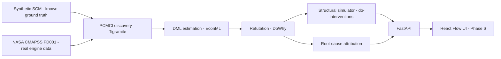

# CausalTwin — Causal Digital Twin & Simulator

**SNH-AI-01 · SpectoV National Hackathon AI Track** — *AI That Discovers Why a System Is Failing*

> Most AI predicts **what** will happen. CausalTwin answers **why** — and what to change.


CausalTwin builds a Structural Causal Model (SCM) of a dynamic system from time-series **and
event** data. It is developed against a synthetic ground-truth SCM (where every claim can be
scored honestly) and demonstrated on NASA CMAPSS turbofan run-to-failure data. The full design
is the aligned v3 blueprint: *CausalTwin Engineering Blueprint & Implementation Roadmap
(Aligned to SNH-AI-01)*.

## What it does

- **Discovers the causal graph** — PCMCI learns which variables actually drive which, with lags, instead of reporting correlations.
- **Simulates `do(X = x')` what-if interventions** — set a lever to a new value and predict the downstream effect before touching the real system.
- **Attributes root causes** — ranks upstream variables by how much of an anomaly each one explains.
- **Recommends the smallest intervention** predicted to prevent or mitigate a failure.
- **Explains itself** — every output ships with a confidence and a plain-language explanation card.

## Why causal, not correlational

A conventional ML model can say *"machine temperature indicates 82% failure probability"*, but it
cannot distinguish **"Sensor X is correlated with the failure"** from **"changing Sensor X would
actually prevent the failure."** Only the second statement tells an operator what to do. CausalTwin
is built to make the second kind of statement — and to prove it on ground truth before claiming
it on real data.

## Architecture



## Results so far

### Environment & tests

| Check | Result |
|---|---|
| Step Zero (clean venv, install, runtime smoke) | Verified on macOS arm64, Python 3.11.9 |
| Test suite | **17 / 17 passing** |
| CMAPSS FD001 file | 20,631 rows · 100 engines · sha256 verified exact match |

### Discovery tuning — synthetic SCM (ground truth known)

Recall is **1.0 in every configuration** — PCMCI never misses a true edge; all error is false
positives, so precision is the battleground.

| Config | n | tau_max | pc_alpha | Precision | Recall | Edge F1 | SHD |
|---|---|---|---|---|---|---|---|
| Baseline | 600 | 2 | 0.01 | 0.4286 | 1.0000 | 0.6000 | 16 |
| **Best** | **2000** | **2** | **0.001** | **0.5714** | **1.0000** | **0.7273** | **9** |

Findings: more data improves precision far more than threshold tuning (SHD 16 → 9 going
n=600 → 2000), and `tau_max=3` hurts at both sizes — more lags means more false positives.
Full sweep: `backend/scripts/discovery_tuning_results.json`.

### CMAPSS discovery smoke run — real data, structure only

Discovery on the longest-lived FD001 engine (unit 69, 362 cycles, 16 usable columns):

| Series | ADF stationary | Edges found |
|---|---|---|
| Raw | 3 / 16 columns | 80 — dense, consistent with common-trend spurious links |
| First-differenced | 16 / 16 columns | 34 — sparser, with physically plausible links (e.g. operating condition → HPC outlet pressure) |

Takeaway: detrending/differencing is required before CMAPSS graphs are interpretable.
**No accuracy is claimed on CMAPSS** — it is observational data with no ground-truth graph;
this run demonstrates structure and plausibility only (see the honest-claims rule below).

### Phase 3 — effect estimation

Estimator smoke run (LinearDML effect vs the SCM's true effect, plus DoWhy refutation) is
**in progress** — no numbers published until the run is complete and checked.

## Project status

- ✅ Phase 0 — starter scaffold (synthetic SCM, discovery, simulator, root-cause, FastAPI)
- ✅ Step Zero — environment locked and verified (see below)
- ✅ Phase 1 — CMAPSS FD001 loader (RUL, capped RUL, constant-sensor handling, ADF stationarity report, per-unit series)
- 🔄 Phase 2 — causal discovery (tuning sweep ✅, CMAPSS smoke run ✅, final config pick pending)
- 🔄 Phase 3 — DML effect estimation + refutation (smoke run in progress)
- ⬜ Phase 4 — counterfactual rollout, root-cause and recommendation endpoints
- ⬜ Phase 5 — benchmark vs correlational LightGBM baseline
- ⬜ Phase 6 — React Flow UI

## Tech stack

| Layer | Technology |
|---|---|
| Language | Python 3.11 (pinned — see Step Zero) |
| API | FastAPI, Pydantic v2, uvicorn |
| Causal discovery | Tigramite (PCMCI) |
| Effect estimation | EconML (LinearDML) |
| Causal modelling / refutation | DoWhy |
| Structural equations / baseline | scikit-learn, LightGBM |
| Stationarity testing | statsmodels (ADF) |
| Graph handling | networkx |
| Data | pandas, numpy, scipy |
| Infra | Docker (`python:3.11-slim`), docker-compose |
| Tests | pytest |
| Frontend | React Flow (Phase 6, planned) |

## Quickstart

Clone the repository:

```bash
git clone https://github.com/Anurag0018/causaltwin.git
cd causaltwin
```

### Step Zero — lock the environment BEFORE writing code

The causal stack (Tigramite / DoWhy / EconML on numpy, scipy, scikit-learn) is extremely
version-sensitive. The pins in `backend/requirements.txt` were **verified together** — resolver,
clean install, and a runtime smoke test (PCMCI run, LinearDML fit, DoWhy `identify_effect`).
Do not bump any of them in isolation; in particular **dowhy is pinned to 0.13 on purpose**
(0.14 requires numpy>2.0 and cannot coexist with the numpy<2.0 stack).

> **Mac note:** the default `python3` on the dev Mac is **3.9**, which is too old
> (Tigramite 5.2.x needs Python ≥ 3.10). Check `python3.11 --version` **first**; if it's
> missing, install Python 3.11 before anything else. Always create the venv with
> `python3.11` explicitly — never bare `python3`.

```bash
cd causaltwin/backend
python3.11 -m venv .venv
source .venv/bin/activate
pip install -r requirements.txt
python scripts/smoke_test.py        # must print: SMOKE TEST PASSED
pip freeze > requirements-lock.txt  # commit this lock file; CI/Docker build from it
```

Run the pre-flight in the **same terminal** you'll work in (exports and venv activation
live only in that terminal):

```bash
which python && python --version    # expect: .../.venv/bin/python, Python 3.11.x
```

Docker alternative:

```bash
docker compose up backend           # python:3.11-slim, uvicorn on :8000
curl localhost:8000/health
```

Run the tests (module form, so the project interpreter and import path are right):

```bash
cd backend && python -m pytest        # from the activated venv
```

## Weekend plan (Sat 28 – Sun 29 Nov 2026)

| When | Phase | Done when |
|---|---|---|
| Sat morning | **Step Zero** | venv on Python 3.11, smoke test passes, `requirements-lock.txt` committed |
| Sat | **Phase 1 — Synthetic SCM & data/event pipeline** | `data_loader.generate()` (already working in the scaffold) extended: CMAPSS loader ✅ implemented (with RUL + preprocessing helpers), ADF report wired into preprocessing ✅ (`stationarity_report()` / `prepare_series()`) |
| Sun | **Phase 2 — Causal discovery** | PCMCI on the synthetic SCM prints its first **SHD + Edge F1** vs the known ground truth (`POST /discover`) |
| Later | Phase 3 DML + refutation → Phase 4 counterfactual/RCA/recommend → Phase 5 benchmark vs correlational LightGBM → Phase 6 React Flow UI | per blueprint |

The scaffold already contains working starter versions of every engine module
(discovery, estimator, simulator, root-cause, updater, explain) so the weekend
starts at Phase 1 code, not at setup.

## Repo map

```
causaltwin/
├── docker-compose.yml          # backend service (+ frontend placeholder, Phase 6)
├── backend/
│   ├── Dockerfile              # python:3.11-slim
│   ├── requirements.txt        # verified pins — see Step Zero
│   ├── app/
│   │   ├── main.py             # FastAPI: /health /discover /intervene /graph/versions /explain
│   │   ├── schemas.py          # Pydantic v2: NodeSpec, EdgeSpec, EventSpec, TwinGraph, ...
│   │   ├── data_loader.py      # synthetic SCM generator (known ground-truth DAG) + event stream + CMAPSS loader + ADF/preprocessing helpers
│   │   ├── discovery.py        # Tigramite PCMCI wrapper + SHD / Edge-F1 metrics
│   │   ├── estimator.py        # EconML LinearDML for treatment→KPI pairs (Phase 3)
│   │   ├── simulator.py        # structural equations + do(X) shift propagation (Phase 4)
│   │   ├── root_cause.py       # residual z-score root-cause ranking
│   │   ├── updater.py          # graph version registry + edge diff (Stage 0)
│   │   └── explain.py          # confidence / explanation cards (§3.5)
│   ├── scripts/
│   │   ├── smoke_test.py               # Step Zero verification
│   │   ├── tune_discovery.py           # Phase 2 PCMCI tuning sweep (+ discovery_tuning_results.json)
│   │   ├── cmapss_discovery_smoke.py   # Phase 2 CMAPSS discovery smoke run (+ cmapss_discovery_smoke.json)
│   │   └── estimator_smoke.py          # Phase 3 estimator smoke run (in progress)
│   └── tests/
│       ├── test_scm_engine.py
│       └── test_cmapss_loader.py
├── frontend/                   # Phase 6 placeholder — see frontend/README.md
├── notebooks/                  # Phase 5 benchmark notebook — see notebooks/README.md
└── data/                       # local datasets (gitignored)
```

## Honest-claims rule (from the blueprint)

Interventional accuracy (SHD, ATE error, intervention RMSE) is claimed **only** from the
synthetic ground-truth SCM, where the true DAG and true effects are known. NASA CMAPSS is
observational run-to-failure data — on that tier CausalTwin demonstrates discovery,
graph updating and root-cause tracing, not intervention accuracy.

## Phase-1 additions (not in the scaffold's requirements)

`xgboost`, `polars` and `duckdb` are deliberately **not** pinned yet. Add them in Phase 1
only after re-running the full smoke test with them included, and regenerate
`requirements-lock.txt` — never add a package to this stack unverified.
