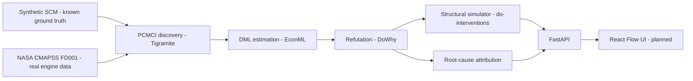

# CausalTwin — Causal Digital Twin & Simulator

*AI that discovers why a system is failing — and what to change to fix it.*

> Most AI predicts **what** will happen. CausalTwin answers **why** — and what to change.


CausalTwin builds a Structural Causal Model (SCM) of a dynamic system from time-series **and
event** data. It is developed against a synthetic ground-truth SCM (where every claim can be
scored honestly) and demonstrated on NASA CMAPSS turbofan run-to-failure data. The full design
is documented in the *CausalTwin Engineering Blueprint & Implementation Roadmap*.

---

## What it does

- **Discovers the causal graph** — PCMCI learns which variables actually drive which, with lags, instead of reporting correlations.
- **Simulates `do(X = x')` what-if interventions** — set a lever to a new value and predict the downstream effect before touching the real system.
- **Attributes root causes** — ranks upstream variables by how much of an anomaly each one explains.
- **Recommends the smallest intervention** predicted to prevent or mitigate a failure.
- **Explains itself** — every output ships with a confidence and a plain-language explanation card.

---

## Why causal, not correlational

A conventional ML model can say *"machine temperature indicates 82% failure probability"*, but it
cannot distinguish **"Sensor X is correlated with the failure"** from **"changing Sensor X would
actually prevent the failure."** Only the second statement tells an operator what to do. CausalTwin
is built to make the second kind of statement — and to prove it on ground truth before claiming
it on real data.

---

## Architecture



---

## Results

Every interventional number below is measured on the synthetic ground-truth SCM, where the
true graph and true effects are known (see the honest-claims rule). Real-data results are
structural only.

### Verification

| Check | Result |
|---|---|
| Environment setup (clean venv, install, runtime smoke) | Verified on macOS arm64, Python 3.11.9 |
| Test suite | **25 / 25 passing** |
| CMAPSS FD001 file | 20,631 rows · 100 engines · sha256 verified exact match |

### Causal discovery

Tuning sweep on the synthetic SCM (full sweep: `backend/scripts/discovery_tuning_results.json`).
Recall is **1.0 in every configuration** — PCMCI never misses a true edge; all error is false
positives, so precision is the battleground.

| Config | n | tau_max | pc_alpha | Precision | Recall | Edge F1 | SHD |
|---|---|---|---|---|---|---|---|
| Baseline | 600 | 2 | 0.01 | 0.4286 | 1.0000 | 0.6000 | 16 |
| **Best** | **2000** | **2** | **0.001** | **0.5714** | **1.0000** | **0.7273** | **9** |

Findings: more data improves precision far more than threshold tuning (SHD 16 → 9 going
n=600 → 2000), and `tau_max=3` hurts at both sizes — more lags means more false positives.

### Effect estimation

LinearDML estimate of the `fan_speed_nc(t) → failure_risk(t+3)` total effect vs the true
effect from pulse simulation on the SCM (common random numbers). Full detail:
`backend/scripts/estimator_smoke_results.json`.

| Quantity | Value |
|---|---|
| LinearDML estimate | **−0.0693** failure-risk points per +1 fan unit (95% CI −0.0764 … −0.0623) |
| True effect on the observed (clipped) outcome | −0.0653 / unit → **ATE error 0.004 / unit** |
| Latent (unclipped) true effect | −0.0958 / unit — the gap vs the estimate is the generator's [0, 100] output clipping, not estimator bias |
| DoWhy refutation | **3 / 3 pass** (random common cause, placebo treatment, data subset) |

### Root-cause attribution

Sustained faults injected into the true dynamics (4 fault nodes × 3 seeds, pre-registered;
ranking by residual z-score):

| Protocol | Top-1 | Top-3 |
|---|---|---|
| Naive (fit on the faulted series, single timestep) | 0.500 | 0.917 |
| **Deployed (fit on the pre-fault reference period, score over the fault window)** | **1.000** | **1.000** |

**Protocol matters.** Fitting on data that contains a sustained fault biases the faulted
node's AR coefficient toward 1 — the model learns to expect the elevated level and the
culprit's z-score collapses (measured +1.0 where ~+3.4 was expected), while one-step
coincidences (a binary maintenance event firing at the scored instant, z = +3.9) spike.
The deployed protocol is how a twin actually runs: reference model from clean history,
anomaly scored over a window.

### What-if simulation and recommendation

The simulator's structural equations include each node's own-lag AR term and propagate
**steady-state** shifts exactly (a one-pass propagation ignores the 1/(1−a) amplification
at every node). Validation — cooling fault active; sustained fan overrides in the true SCM
vs simulator predictions (failure-risk points):

| Fan change | Latent analytic | Steady-state simulator | One-pass simulator | Actual (observed) |
|---|---|---|---|---|
| +40 rpm | −15.90 | −12.36 | −8.04 | −10.14 |
| +80 rpm | −31.80 | −24.72 | −16.08 | −20.02 |
| +120 rpm | −47.70 | −37.08 | −24.11 | −28.84 |
| **RMSE** | — | **5.63** (vs latent: **7.65**) | 3.75 (vs latent: 16.99) | — |

Read this honestly: against the *latent* system the steady-state simulator is far closer
(RMSE 7.65 vs 16.99). Against the *observed* outcome the one-pass simulator's RMSE is
lower on this scenario — its two errors (parent coefficients inflated by the omitted
own-lag term; no steady-state amplification) partially cancel. The latent→observed
attenuation (~11.8 of 31.8 points at +80 rpm) is the [0, 100] clip on observed
failure_risk: the latent series is high-variance (std ≈ 4 z, because the nodes share the
load driver), so both clips bite.

**Recommendation** — target: undo the cooling fault's +19.95-point failure-risk
elevation. The recommendation engine (`POST /recommend`) picks the smallest sufficient
change: **fan_speed_nc +70 rpm (+3.1%)**, predicted reduction 21.63 points; measured in
the true SCM it achieves 17.60 points (88% of target — short by the same observed-scale
overprediction documented above). The explanation card it ships:

> Increasing fan_speed_nc by 3.1% is predicted to reduce failure_risk by 60.2%
> [95% CI 54.0 to 61.3], because fan_speed_nc drives coolant_temp, which drives
> hpc_outlet_temp, which drives failure_risk. Changing power_draw produces negligible
> improvement. Graph v1, refutation: passed.

(`power_draw` is the honest negligible alternative: strongly correlated with failure_risk,
but with no causal path to it, its predicted effect is exactly 0.)

### Benchmark vs a correlational baseline (LightGBM)

The project's thesis — *prediction ≠ intervention* — tested head-to-head (script and
results JSON in `backend/scripts/`; readable version: `notebooks/benchmark.ipynb`). Both
models are trained on the **same** normal-operation data (n=2000, seed 0). The baseline is
the standard "just ML" approach: a LightGBM regressor predicting `failure_risk` from the
current state snapshot (all other nodes, incl. the lever and `power_draw`); its what-if is
the practitioner's one — bump the lever feature, hold everything else natural. Ground
truth for interventions comes from the true dynamics (step hooks in the SCM replica,
settled window, same protocol as the what-if validation above).

**Intervention prediction** — predicted vs actual failure-risk change (points) under
sustained `do(fan_speed_nc)` overrides:

| Scenario | Fan change | Actual | Causal twin | LightGBM |
|---|---|---|---|---|
| normal | +40 rpm | −8.83 | −12.36 | −0.09 |
| normal | +80 rpm | −16.15 | −24.72 | −0.52 |
| normal | +120 rpm | −22.12 | −37.08 | −0.74 |
| cooling fault | +40 rpm | −10.14 | −12.36 | −0.16 |
| cooling fault | +80 rpm | −20.02 | −24.72 | −0.52 |
| cooling fault | +120 rpm | −28.84 | −37.08 | −0.77 |
| **RMSE** | | | **8.21** | **18.46** |

The baseline's what-if is essentially *"nothing happens"* (−0.1 … −0.8 points against a
true −9 … −29): the fan reaches failure_risk only through a lagged chain
(fan → coolant → HPC temperature → risk), so a snapshot model's lever feature carries
almost no signal — and a single-output regressor has no mechanism to move the mediators.
That failure is structural, not a tuning problem. The causal twin overpredicts magnitude
(linear steady state vs the [0, 100]-clipped observed outcome — the same observed-scale
effect documented above; its cooling-fault RMSE of 5.63 reproduces the what-if validation
number exactly) but gets direction, ordering and most of the size.

**In-distribution prediction** (honesty check — held-out natural run, seed 1, no
interventions): causal one-step RMSE **6.84** vs LightGBM snapshot RMSE **12.10**. The
causal model wins here too on this system, because it predicts from the true lagged
parents while the snapshot model infers state from contemporaneous correlates. Reported
plainly, but it is not the load-bearing claim: on a system whose KPI parents were
directly and contemporaneously observed, a correlational model could match it at pure
prediction — and would still fail the intervention test above.

**Root cause** — the same injected-fault set as above (4 faults × 3 seeds):

| Method | Top-1 | Top-3 |
|---|---|---|
| **Causal RCA (per incident)** | **1.000** | **1.000** |
| LightGBM gain importance (global) | 0.250 | 0.750 |

Importance ranking: oil_pressure > hpc_outlet_temp > vibration > load > coolant_temp >
fan_speed_nc > power_draw > maintenance_event. One global ranking is scored against
every incident: importance has no per-incident view, so a fault at `coolant_temp`
(rank 5) is unfindable by it no matter how clean the incident — that asymmetry is part
of what is being measured, and it is how practitioners actually use importance for
diagnosis. (Causal RCA recomputed in the benchmark run; it reproduces the root-cause
result above exactly.)

### Real data: NASA CMAPSS

Discovery on the longest-lived FD001 engine (unit 69, 362 cycles, 16 usable columns):

| Series | ADF stationary | Edges found |
|---|---|---|
| Raw | 3 / 16 columns | 80 — dense, consistent with common-trend spurious links |
| First-differenced | 16 / 16 columns | 34 — sparser, with physically plausible links (e.g. operating condition → HPC outlet pressure) |

Takeaway: detrending/differencing is required before CMAPSS graphs are interpretable.
**No accuracy is claimed on CMAPSS** — it is observational data with no ground-truth graph;
this demonstrates structure and plausibility only (see the honest-claims rule below).

---

## Quickstart

Clone the repository:

```bash
git clone https://github.com/Anurag0018/causaltwin.git
cd causaltwin
```

### Step Zero — lock the environment BEFORE writing code

The causal stack (Tigramite / DoWhy / EconML on numpy, scipy, scikit-learn) is extremely
version-sensitive. The pins in `backend/requirements.txt` were **verified together** — resolver,
clean install, and a runtime smoke test (PCMCI run, LinearDML fit, DoWhy `identify_effect`).
Do not bump any of them in isolation; in particular **dowhy is pinned to 0.13 on purpose**
(0.14 requires numpy>2.0 and cannot coexist with the numpy<2.0 stack).

> **Mac note:** the default `python3` on the dev Mac is **3.9**, which is too old
> (Tigramite 5.2.x needs Python ≥ 3.10). Check `python3.11 --version` **first**; if it's
> missing, install Python 3.11 before anything else. Always create the venv with
> `python3.11` explicitly — never bare `python3`.

```bash
cd causaltwin/backend
python3.11 -m venv .venv
source .venv/bin/activate
pip install -r requirements.txt
python scripts/smoke_test.py        # must print: SMOKE TEST PASSED
pip freeze > requirements-lock.txt  # commit this lock file; CI/Docker build from it
```

Run the pre-flight in the **same terminal** you'll work in (exports and venv activation
live only in that terminal):

```bash
which python && python --version    # expect: .../.venv/bin/python, Python 3.11.x
```

Docker alternative:

```bash
docker compose up backend           # python:3.11-slim, uvicorn on :8000
curl localhost:8000/health
```

Run the tests (module form, so the project interpreter and import path are right):

```bash
cd backend && python -m pytest        # from the activated venv
```

---

## Tech stack

| Layer | Technology |
|---|---|
| Language | Python 3.11 (pinned — see Step Zero) |
| API | FastAPI, Pydantic v2, uvicorn |
| Causal discovery | Tigramite (PCMCI) |
| Effect estimation | EconML (LinearDML) |
| Causal modelling / refutation | DoWhy |
| Structural equations / baseline | scikit-learn, LightGBM |
| Stationarity testing | statsmodels (ADF) |
| Graph handling | networkx |
| Data | pandas, numpy, scipy |
| Infra | Docker (`python:3.11-slim`), docker-compose |
| Tests | pytest |
| Frontend | React Flow (planned) |

---

## Repo map

```
causaltwin/
├── docker-compose.yml          # backend service (+ frontend placeholder)
├── backend/
│   ├── Dockerfile              # python:3.11-slim
│   ├── requirements.txt        # verified pins — see Step Zero
│   ├── app/
│   │   ├── main.py             # FastAPI: /health /discover /intervene /recommend /graph/versions /explain
│   │   ├── schemas.py          # Pydantic v2: NodeSpec, EdgeSpec, EventSpec, TwinGraph, ...
│   │   ├── data_loader.py      # synthetic SCM generator (known ground-truth DAG) + event stream + CMAPSS loader + ADF/preprocessing helpers
│   │   ├── discovery.py        # Tigramite PCMCI wrapper + SHD / Edge-F1 metrics
│   │   ├── estimator.py        # EconML LinearDML for treatment→KPI pairs
│   │   ├── simulator.py        # structural equations (own-lag terms) + steady-state do(X) propagation
│   │   ├── faults.py           # SCM replica with fault-injection + ground-truth intervention hooks
│   │   ├── recommend.py        # smallest-sufficient-intervention engine + bootstrap CI
│   │   ├── root_cause.py       # residual z-score root-cause ranking (clean-reference fit + windowed scoring)
│   │   ├── updater.py          # graph version registry + edge diff
│   │   └── explain.py          # confidence / explanation cards
│   ├── scripts/
│   │   ├── smoke_test.py               # Step Zero verification
│   │   ├── tune_discovery.py           # PCMCI tuning sweep (+ discovery_tuning_results.json)
│   │   ├── cmapss_discovery_smoke.py   # CMAPSS discovery smoke run (+ cmapss_discovery_smoke.json)
│   │   ├── estimator_smoke.py          # effect-estimation smoke run (+ estimator_smoke_results.json)
│   │   ├── phase4_end_to_end.py        # end-to-end run: fault → root cause → what-if → recommendation (+ phase4_results.json)
│   │   └── benchmark_baseline.py       # benchmark vs LightGBM baseline (+ benchmark_results.json)
│   └── tests/
│       ├── conftest.py
│       ├── test_scm_engine.py
│       ├── test_cmapss_loader.py
│       ├── test_phase4.py
│       └── test_benchmark.py
├── frontend/                   # web UI placeholder — see frontend/README.md
├── notebooks/                  # benchmark notebook (benchmark.ipynb) — see notebooks/README.md
└── data/                       # local datasets (gitignored)
```

---

## Honest-claims rule

Interventional accuracy (SHD, ATE error, intervention RMSE) is claimed **only** from the
synthetic ground-truth SCM, where the true DAG and true effects are known. NASA CMAPSS is
observational run-to-failure data — on that tier CausalTwin demonstrates discovery,
graph updating and root-cause tracing, not intervention accuracy.

---

## Status

Backend engine complete and tested (25 tests) — discovery, effect estimation with
refutation, root-cause attribution, what-if simulation, recommendations with explanation
cards, and the LightGBM benchmark are all in and measured. Web UI and deployment are next.

---

## Development notes

**Optional extras — not yet pinned.** `xgboost`, `polars` and `duckdb` are deliberately
**not** pinned yet. Add them only after re-running the full smoke test with them included,
and regenerate `requirements-lock.txt` — never add a package to this stack unverified.
